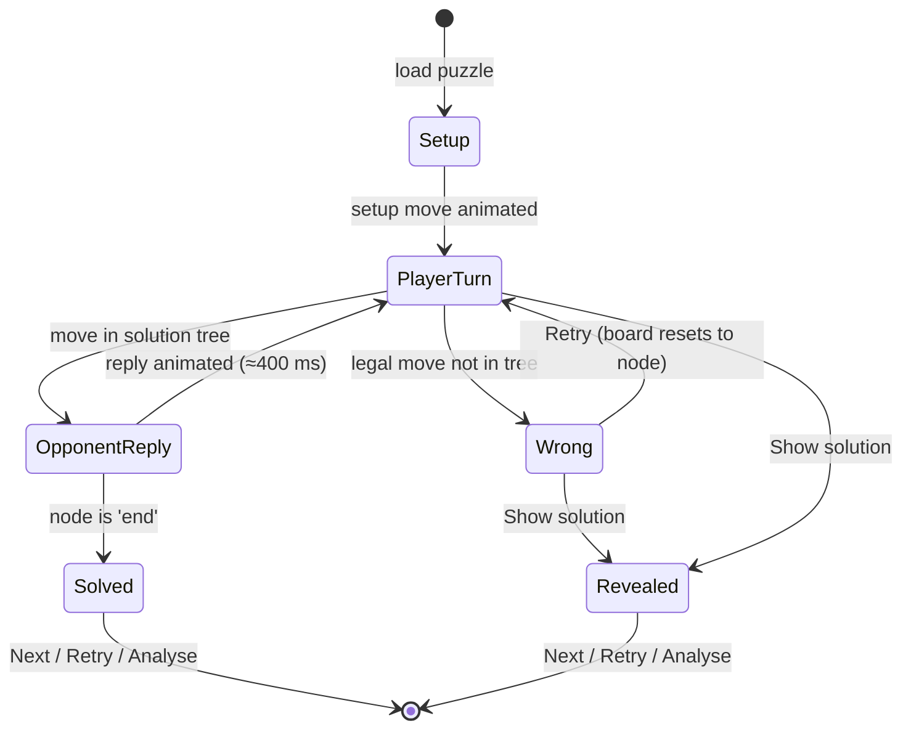

# Puzzle Revamp Plan

**Status:** Draft for review · **Scope:** Puzzle content, puzzle UI and UX, puzzle progress · **Related:** [session_context/puzzle_locations.md](session_context/puzzle_locations.md)

---

## 1. Where we are today

| Area | Current state | Problem |
|---|---|---|
| Content | 4 hand-written puzzles in `src/game/puzzles.ts`, one per variant | Too few to keep players interested. There is no difficulty progression and no themes. |
| Puzzle depth | Each puzzle is a single move (`solutionRoutes: string[]`) | Real combinations take several moves: you sacrifice, the opponent must take, then you finish. We can't represent that today. |
| Solving UI | `learn.tsx` lists **every legal move as a button** | The answer is always on screen. The player picks from a list instead of reading the board. There is no board to play on. |
| Feedback | One line of text and a single text hint | The player doesn't see the opponent reply, there are no step-by-step hints, and there's no way to watch the solution. |
| Progress | `solvedPuzzles: string[]` in `GameContext` | We don't record attempts, first-try solves, hint use, streaks or a rating. |
| Placement | A card in the middle of the Learn page | Hard to find. It doesn't feel like a feature in its own right. |

**Goal:** turn puzzles into a core daily feature with **hundreds of verified puzzles across all 4 variants**. Players solve them **on the real board**, with multi-move solutions, step-by-step hints, a puzzle rating and a daily puzzle. Everything works offline.

---

## 2. Content strategy

### 2.1 Source tiers (ordered by licensing safety)

> [!IMPORTANT]
> Many of the leads in `puzzle_locations.md` are **not verified yet**. That includes URLs, collection sizes and licences. Only the Lidraughts data format was checked against a live response. Treat everything else as a lead to confirm before importing anything.

| Tier | Source | Variants | Licensing status | How we use it |
|---|---|---|---|---|
| **A** | **Puzzles we generate ourselves** with our own engine (`src/game/ai.ts`) | All 4 | ✅ No third-party rights | Main source of volume (see 2.3) |
| **B** | **Public-domain classics**: Sturges *Guide to the Game of Draughts* (1800), Gould *Problem Book* (1884), other pre-1929 works | English | ✅ Public domain by age (confirm the edition we copy from) | Hand-transcribe a curated "Classics" pack and give each puzzle a historical attribution |
| **C** | **Lidraughts training** (`lidraughts.org/training`, `/training/russian`) | International, Russian | ⚠️ Puzzle licence not confirmed. There is no bulk export. | **Ask the maintainer (RoepStoep) for permission first.** Don't scrape. If we get permission, use the importer in 2.4. |
| **D** | Richard Pask books, The Checker Maven, FMJD CPI, KNDB / Jeugddammen, Aurora Borealis / shashki.com | Various | ❌ Copyrighted, or terms unknown | Only with written permission. Until then, use them as **curriculum references** for motif names and teaching order, not as data. |

### 2.2 Puzzle schema v2

This replaces the current `Puzzle` interface. It stays backward compatible during migration.

```ts
export type Motif =
  | 'shot-2for1' | 'shot-3for1' | 'breeches' | 'slip-shot' | 'in-and-out'
  | 'crown-sweep' | 'mid-capture-promotion' | 'king-trap' | 'blockade'
  | 'tempo-opposition' | 'first-position' | 'coup-royal' | 'coup-turc'
  | 'coup-philippe' | 'max-capture' | 'quiet-move' | 'endgame-draw';

export type PuzzleGoal = 'win' | 'win-material' | 'crown' | 'blockade' | 'draw';

export interface PuzzleV2 {
  id: string;                    // stable, e.g. 'eng-gen-000123', 'eng-sturges-017'
  variant: VariantId;
  fen: string;                   // position the player solves (after any setup move)
  setupMove?: string;            // opponent's last move, animated in for context (Lidraughts style)
  goal: PuzzleGoal;
  /** Solution tree: player moves → forced/best opponent replies → … Keys are full routes ('c3-e5-g7'). */
  solution: SolutionNode;
  rating: number;                // initial Glicko rating; recalibrated from player results later
  motifs: Motif[];
  title?: string;                // optional: curated puzzles only
  hints: [string, string?, string?]; // progressive: idea → piece → square
  source: { kind: 'generated' | 'public-domain' | 'licensed'; attribution?: string; license?: string; url?: string };
}

export interface SolutionNode { [playerRoute: string]: { reply?: string; next?: SolutionNode } | 'end' }
```

Notes:
- **Several correct answers:** list every route that wins equally well at a node. Russian puzzles already do this (`b6-d8-g5` and `b6-d8-h4`).
- **The opponent's reply is fixed** in the data. The engine is used only to *validate* the data, never at solve time. This keeps solving fast and fully offline.

### 2.3 Generating puzzles in-house (Tier A pipeline)

This is a Node script, `scripts/mine-puzzles.mjs`, that runs offline on a dev machine. It never runs on device.

1. **Candidate positions:** use engine self-play at mixed Elo levels (400–2400) for each variant. Optionally add positions from local game archives with the user's consent. Cap at roughly 50k candidate positions per variant.
2. **Tactic filter:** keep a position when, at analysis depth:
   - the best move scores at least **+1.50** (about 1.5 men) better than the second-best move, **and**
   - the position stays balanced (within ±0.75) if the side to move plays quietly instead. This is the "only move" test.
3. **Extend the line:** follow the PV. At each opponent turn, record the engine's best reply. At each player turn, apply the uniqueness test again. Stop when the material gain is locked in, or after 9 plies at most.
4. **De-duplicate:** use `positionKey()` and mirror symmetry to remove duplicates.
5. **Auto-tag motifs** with heuristics: number of captures in the winning move (2-for-1, 3-for-1), sacrifice followed by a multi-jump, promotion during a capture (Russian), crown move, the opponent having no legal moves (blockade).
6. **Seed rating** from search depth needed × line length × number of sacrifices. Map it to a band: Beginner < 1200, Intermediate 1200–1800, Advanced > 1800.
7. **Write packs** to `assets/puzzles/<variant>.json`.

### 2.4 Lidraughts importer (Tier C, only after permission)

We confirmed this format against a live response:
- The page embeds `lidraughts.puzzle = {"data":{"puzzle":{ id, variant, rating, fen, color, initialPly, lines, branch }, "history": {...}}}`.
- The `fen` field carries `:H0:Fnn` suffixes that our `fromFen` **rejects**. Strip them before parsing.
- `puzzle.fen` is the position **before** the opponent's setup move. `history.fen` / `history.uci` hold that setup move. Map them to `setupMove` + `fen`.
- In `lines`, moves are stored as 4-digit `from+to` pairs (`"1302"` = 13→2). Each hop of a multi-capture appears as its own step in `branch`. The importer must join the hops into one full route by matching our `legalMoves()` on `from`, `to` and `captures`.
- Square numbering looks the same as ours (1 = top-left playable square on the black side). Verify this per variant by replaying every line through our engine. Reject any puzzle that doesn't replay cleanly.

### 2.5 Mandatory validation (CI gate for every pack)

This extends `tests/engine.test.ts` ("All tactical puzzles have valid positions…") into a dedicated `tests/puzzles.test.ts`:

- [ ] The FEN parses with `fromFen` for the stated variant, and the side to move matches the puzzle.
- [ ] Every route in the solution tree is a legal move at its node. Every opponent reply is legal.
- [ ] The final position meets the `goal` (material swing, crown, blockade, or `outcome()` result).
- [ ] *(slow, nightly / script only)* the engine confirms each player move is unique within the threshold from 2.3.
- [ ] Every non-generated puzzle has `source.attribution` and `source.license`.
- [ ] IDs are unique across all packs. Pack size stays within budget (see 2.6).

### 2.6 Volume targets and bundling

| Variant | Phase 1 | Phase 2 | Motif focus |
|---|---|---|---|
| English | 150 (100 generated + 50 Sturges/Gould classics) | 400 | Shots, breeches, first/second position, king traps |
| International | 100 | 400 | Flying-king sweeps, max capture, classic coups |
| Russian | 100 | 300 | Promotion during a capture, backward captures, triangle king trap |
| Brazilian | 75 | 250 | Max capture with flying kings, blockades |

- Packs are compact JSON, one file per variant, around 150 bytes per puzzle. That keeps 400 puzzles to about 60 KB. They're bundled in the app and loaded lazily per variant.
- New packs can ship through **EAS Update** (OTA) without a store release, because they're JS/asset only.

---

## 3. UI and UX revamp

### 3.1 Information architecture

- **New routes** (Expo Router, in `src/app/`):
  - `src/app/puzzles/index.tsx`: Puzzle hub
  - `src/app/puzzles/[id].tsx`: Puzzle solver (opened from a link or `router.push`)
  - `src/app/puzzles/_layout.tsx`: stack navigator
- **Entry points:** a prominent "Puzzles" card at the top of Learn, a **Daily puzzle** chip on the Play screen, and a deep link `draughtsclub://puzzles/<id>` (the scheme is already in `app.json`).
- **Open question:** should Puzzles get a **5th tab** in `Shell.tsx`? The four current tabs leave room, but a 5th tab makes each one narrower on small phones. See §7.

### 3.2 Puzzle hub (`/puzzles`)

```
┌─────────────────────────────────┐
│ Puzzles            Rating 1340 ▲│
│ ┌─────────────────────────────┐ │
│ │ ☀ Daily puzzle   [MiniBoard]│ │  ← same for every player each day, picked by date
│ │ English · 2-for-1 shot      │ │
│ │ [ Solve ]   🔥 4-day streak │ │
│ └─────────────────────────────┘ │
│ [English][Intl][Russian][Braz.] │  ← variant filter (defaults to config.variant)
│ ▶ Continue: Rated training      │  ← next puzzle near your rating
│ Themes                          │
│ ┌──────┐┌──────┐┌──────┐        │
│ │Shots ││Crown ││Block-│ …      │  ← motif collections with a progress ring
│ │ 12/40││ 3/25 ││ade   │        │
│ └──────┘└──────┘└──────┘        │
│ Classics (Sturges 1800) 5/50    │
│ Stats: solved · first-try % · best streak │
└─────────────────────────────────┘
```

### 3.3 Puzzle solver (`/puzzles/[id]`)

**Players solve on the real board.** We remove the move-button list completely.

- Reuse `Board` (`src/components/Board.tsx`). It already supports `selected`, `destinations`, `path`, `lastMove`, `hint` and `onSquare`. Reuse the selection and multi-capture logic from `GameScreen` by moving it into a shared `useBoardInput` hook.
- **Orientation:** show the board from the solving side's point of view (`flipped` when Coral is to move).
- **Setup move:** when a puzzle has `setupMove`, play it in with the existing move animation so the player sees what the opponent just did.
- **Header:** goal ("Ivory to play and win 2 men"), variant badge, rating, motif chips. Motifs stay hidden until the puzzle is solved, so they don't give the answer away.
- **Feedback states and sounds** (wired into `FeedbackProvider`):



- **Step-by-step hints** (each one uses up some of the rating reward):
  1. Text idea (`hints[0]`), for example "Look for a sacrifice that opens the long diagonal".
  2. Highlight the **piece** to move (`selected` ring).
  3. Highlight the **destination** (`hint` arrow).
- **Show solution:** step through the whole line with ◀ ▶ controls and short notes. Moves use the existing `notation()` so each variant shows its standard notation.
- **After solving:** a sheet with "Correct in 1st try · +12", **Next puzzle**, **Retry**, **Open in Analysis** (keeps the current `setStudy(newTree(...))` flow) and **Copy FEN**.
- **New sound cues:** add `puzzleCorrect` and `puzzleWrong` to `FeedbackCue` in `src/feedback/events.ts`, with matching assets and haptics (Confirm / Reject on Android, notification Success / Error on iOS).

### 3.4 Accessibility and mobile polish

- Every square keeps an accessible label (`"Square 22, Ivory man"`). Announce state changes ("Correct. Coral replies 18 takes 27") through `accessibilityLiveRegion`.
- Honour Reduce Motion (`useMotion`): the setup move and opponent reply jump straight into place instead of animating.
- All tap targets are at least 44 pt. The board width comes from `useWindowDimensions` with the same sizing as `GameScreen`. Landscape and tablet layouts put the board and side panel side by side.
- **Dark mode:** none today (`userInterfaceStyle: light`), so nothing changes, but new styles use the `C` tokens only.

---

## 4. State, progress and rating

Replace `solvedPuzzles: string[]` in `GameContext` with a dedicated `PuzzleProgress` store (`src/state/PuzzleContext.tsx`). This keeps puzzle updates from re-rendering the game tree.

```ts
interface PuzzleRecord { attempts: number; solved: boolean; firstTry: boolean; hintsUsed: 0|1|2|3; lastPlayed: number }
interface PuzzleProgress {
  version: 2;
  records: Record<string, PuzzleRecord>;
  rating: Record<VariantId, { r: number; rd: number }>;   // Glicko-lite per variant, start 1200 / RD 350
  daily: { date: string; id: string; solved: boolean };
  streak: { current: number; best: number; lastDate: string };
}
```

- **Migration:** on load, every ID in the old `solvedPuzzles` becomes `{ solved: true, firstTry: false, attempts: 1 }`. The current 4 puzzle IDs move into the English, Russian, Brazilian and International packs unchanged, so no progress is lost.
- **Rating update:** expected score from Glicko. Reward = K × (result − expected), scaled down by 25% per hint used. A wrong first move counts as a loss even if the player solves it later.
- **Picking the next puzzle:** an unsolved puzzle within ±150 of the player's rating, preferring motifs they haven't practised much.
- **Daily puzzle:** `hash(YYYY-MM-DD) mod pack.length`, taken from a curated subset. It's the same on every device, offline.
- Stored in AsyncStorage under a separate key (`puzzle-progress-v2`).

---

## 5. Delivery phases

| Phase | Deliverables | Acceptance criteria |
|---|---|---|
| **0. Foundations** (≈2 days) | `PuzzleV2` types, pure solver state machine `src/game/puzzleSession.ts`, pack loader, `tests/puzzles.test.ts`, migration of the 4 existing puzzles | `npm test` passes. The existing 4 puzzles play through the new session API. |
| **1. Solver UI** (≈3–4 days) | `/puzzles/[id]` with board input, setup move, opponent replies, wrong/retry, step-by-step hints, solution playback, new sound cues | Every existing puzzle solves on the board on iOS, Android and web. Playwright `test:ui` covers solve, wrong, hint and reveal. |
| **2. Content v1** (≈4–5 days) | `scripts/mine-puzzles.mjs`, generated packs for 4 variants, 50 hand-transcribed Sturges/Gould classics | Phase 1 targets in §2.6 met. Every puzzle passes the CI gate and the nightly uniqueness check. |
| **3. Hub & progress** (≈3 days) | `/puzzles` hub, themes, `PuzzleContext`, rating, streaks, daily puzzle, Learn and Play entry points | Progress survives an app restart and migration from v1 save data. The daily puzzle is the same across devices. |
| **4. Polish & extras** | Puzzle Rush (timed, 3 strikes), share puzzle link, Lidraughts import (only if permission is granted), OTA content packs | Decided after Phase 3 review |

Every phase ends with `npx tsc --noEmit`, `npx expo lint` and `npm test` passing.

---

## 6. Files touched (expected)

| File | Change |
|---|---|
| `src/game/puzzles.ts` | Becomes types + pack loader. The current puzzles move into packs. |
| `src/game/puzzleSession.ts` | **New:** pure solver state machine (node-testable) |
| `src/state/PuzzleContext.tsx` | **New:** progress, rating, daily, streak, v1→v2 migration |
| `src/state/GameContext.tsx` | Remove `solvedPuzzles` / `markPuzzleSolved` after migration |
| `src/app/puzzles/_layout.tsx`, `index.tsx`, `[id].tsx` | **New** routes |
| `src/app/learn.tsx` | Replace the inline puzzle card with an entry card to `/puzzles` |
| `src/components/GameScreen.tsx` | Move tap/multi-capture input into `src/hooks/useBoardInput.ts` |
| `src/feedback/events.ts`, `FeedbackProvider.tsx` | `puzzleCorrect` / `puzzleWrong` cues |
| `assets/puzzles/*.json` | **New** content packs |
| `scripts/mine-puzzles.mjs` | **New** offline generator |
| `tests/puzzles.test.ts` | **New** validation gate |

---

## 7. Risks and open questions

1. **5th tab or Learn entry?** A 5th tab is easier to find. Keeping four tabs keeps them wider on small phones.
2. **Lidraughts content:** should we contact the maintainer for permission? If not, Tier C stays out of scope.
3. **Generated puzzle quality** depends on how strong our engine is at its analysis depth. Mitigation: strict uniqueness thresholds, a manual review of the first 50 per variant, and a "Report puzzle" button that marks a puzzle for removal in the next OTA pack.
4. **English colour conventions:** classic English literature has *Black* moving first, from squares 1–12. Check how `VARIANTS.english.first` and the Ivory/Coral naming map to that, so transcribed classics aren't flipped.
5. **Rating per variant or global?** The proposal is per variant, because the tactics differ a lot between variants.

